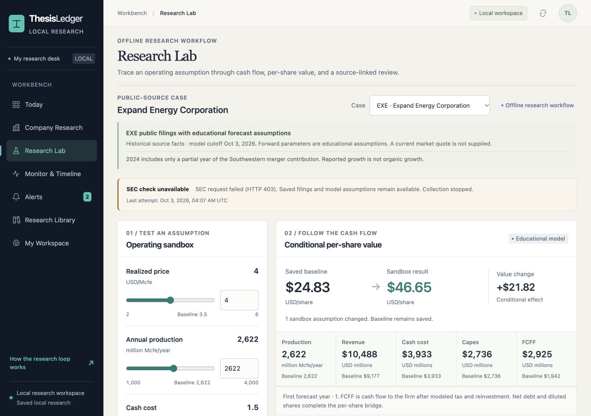

# ThesisLedger

### Build your own investment research workbench

ThesisLedger is an open-source personal investment research workbench that runs on your own machine. Put the company research you have prepared, your assumptions, and the evidence you have checked into a workspace you manage. When new disclosures appear, compare them with your earlier view and keep a record of why you changed it. Set up the research process around the questions you care about. When useful, work alongside an AI agent of your choice to find sources, check definitions, and test scenarios.

**How can you use an AI agent to help you invest?** Begin with a question you really want to answer. Tell the agent what you already know and where your uncertainty lies. Ask it to follow the business from industry change to cash flow, find supporting and opposing evidence, and test scenarios. Then trace important figures back to original sources. Your experience helps decide where to look; the evidence tests the explanation; new facts may require a different view.

[中文](README.zh-CN.md) · [Follow the research journey](#start-with-a-thesis) · [Run the workbench](#get-the-workbench-running) · [Bring your own data](#start-with-your-own-company) · [Agent guide](agents/START_HERE.md)



*The screenshot shows the EXE teaching case. The built-in Agent review is connected to this example workspace.*

## Start with a thesis

Suppose you think rising natural-gas demand could make a producer more valuable. That is a useful starting point, but it does not yet tell you how much the company might earn or what each share might be worth. Where will the demand appear? Can the company deliver into that market? What determines its realized price? How much would it cost to increase production? Each link can change the answer.

You may know the industry well enough to suspect that processing, transportation, or long-term contracts will matter more than headline demand. Give that context to the agent so it can investigate the right questions. Your experience points the research in a direction; company disclosures still need to show what capacity is available, how contracts work, what expansion would cost, and what remains unknown.

One way to map the question is:

```text
Industry demand → ability to serve it → saleable output and realized price
                → costs and reinvestment → available cash → value per share
```

Ask the agent to work through the chain and show the evidence and gaps at each step. If it jumps from “demand is growing” to “the company will benefit,” ask it to fill in the missing links. An unknown input should stay visible until the evidence supports a value.

## Turn your experience into questions an agent can check

“Analyze this stock” leaves the agent guessing about the question that matters to you. Begin with your tentative view: what change could affect the company, why do you think it matters, which part comes from your experience, and which part is still a guess? Say what you are least sure about.

For example:

> I think rising natural-gas demand could improve this company's cash flow because ____. What I know best is ____. What I am least certain about is ____. Trace the question from demand through saleable output, realized price, costs, and reinvestment to cash flow and value per share. For important figures, give me the original source, period, unit, and definition. If the evidence is incomplete, show the gap and find the evidence most likely to challenge my view.

That context gives the agent a defined task and makes your starting point visible. It can widen the search, compare materials, and point out what you may have missed. You still need to decide whether the questions fit the business and whether the evidence supports the conclusion.

## Treat a citation as a path back to the source

When you see a figure, check the company, business scope, reporting period, unit, and definition. “Production growth” might compare a daily rate with a period total, or a year before an acquisition with a year that includes the acquired business. If the scope does not match, correct arithmetic can still answer the wrong question.

Then ask what kind of statement you are reading. What did the company report? How are you interpreting it? What assumptions does the model add to say something about the future? Higher sales may be a reported result. Attributing them to a durable competitive advantage is an interpretation. Assuming that advantage will last for several years is a model assumption. Each may matter, but keeping them distinct shows what the conclusion depends on.

An agent's link is a route to the source, not proof that the source supports its sentence. Open the filing and check the passage, and confirm the information was available by the date of the decision. A real number from a filing does not automatically prove an explanation about the future.

## Invite evidence that could change your view

If you already like a company, ask the agent to build the strongest alternative explanation it can find. Instead of requesting one bullish paragraph and one bearish paragraph, ask what observable evidence could distinguish the explanations. If you think stronger demand will lift realized prices, what could contract terms, regional differentials, or new capacity tell you? What result would make you reconsider?

This turns an opinion into a claim you can revisit. Save the supporting evidence, counterevidence, and future observations with their dates. When a new disclosure arrives, compare it with what the original view expected. The agent can surface contradictions; you judge how much they matter in light of the business, your time horizon, and the question you are researching.

## Use a model to ask “what if?”

A model makes assumptions and their relationships easier to inspect. Try a lower realized price, higher capital spending, or slower growth, then follow the effect on revenue, cash flow, and value per share under those assumptions. Change one important input at a time and inspect the intermediate calculations, not only the final number.

In the EXE example, move **Realized price** from 3.5 to 4.0 USD/Mcfe and see how revenue, cash costs, capital spending, and FCFF respond. The result is conditional on the other premises staying fixed. The case uses a finite forecast period and zero terminal value, among other simplifications; it does not complete the financing, hedging, or dilution analysis. It demonstrates how to inspect inputs, run a scenario, and review the result, not a complete valuation.

Reproducing the same result from the same inputs and code shows that the calculation can be repeated. It does not prove the evidence is complete, the assumptions are reasonable, or the model captures every important feature of the business. Precision in the output cannot repair a weak premise.

## Ask what the current price already assumes

A scenario valuation tells you what follows from a set of assumptions; it does not tell you what the market price requires. For supported industrial and recurring-revenue models, provide a dated share price and the workbench can solve for one operating requirement while holding the other inputs fixed, then feed that requirement back through the forward model.

This is a conditional calculation. One solved driver cannot explain every expectation in a market price, and it does not show that the company will meet that requirement. It turns “this looks cheap or expensive” into a more specific question to research. The EXE commodity case has no supplied market quote and does not support this reverse solution. See [research methods](docs/METHODS.md) for model scope and limitations.

## When an alert arrives, review the reasoning it touches

A new filing is not automatically good news or bad news. Open the source, identify what is new, then ask which part of the research it affects. Did production change? Did a contract or cost assumption change? Is a headline repeating information that was already disclosed?

For a company on your watchlist, only material events that meet the alert conditions create a local alert. Other events may still be recorded. An alert does not change the accepted research baseline. Review the source, propose any update, inspect the before-and-after values, and explicitly accept it. Later, you can see which evidence and edits led to a changed view.

## Keep a dated forecast to review later

Before a forecast period begins, save the predicted value, assumptions, and date. When an attributable observation becomes available, compare it on the same basis. Keep the original forecast intact rather than adjusting it after the outcome is known.

The workbench can freeze forecast cohorts, preserve earlier versions, and compare them with observations you provide after the horizon. Review process as well as outcome: a good result can include luck, and a poor one can reflect a change you could not have anticipated. One forecast says little about investing skill, but a full record can reveal which assumptions you repeatedly overstate or which operating constraints you tend to miss.

## Make the workbench your own

ThesisLedger runs locally by default and is designed for one researcher. Each company workspace can keep its research view, model inputs, evidence, events, alerts, and run history together. You can open the EXE case to explore the interface, or go straight to a workspace for your own company.

Your research packet must follow the [input contract](docs/DATA_CONTRACT.md) and use structured JSON for the company baseline, model assumptions, and sourced evidence. The importer does not turn PDFs, spreadsheets, or notes into usable data, and it does not collect complete filings for any ticker. Current models cover selected industrial businesses, recurring-revenue businesses, and a bounded set of commodity producers. Other business types need a model adapter.

You can use an AI agent of your choice alongside the workbench. The [collaboration guide](agents/START_HERE.md) explains how to prepare company data and event records. The built-in four-tool review flow is currently connected only to EXE; the browser's **Model assistant** is not connected to general custom workspaces. A hosted LLM is optional and must be configured by you. Live inference has not been verified, and selected research context is sent to the provider you configure. Review that context first.

## Get the workbench running

You need Python 3.10 or newer. Choose the path that fits your needs.

### Optional: explore the offline EXE case

The case needs no data key, model account, or third-party runtime dependency:

~~~sh
python3 run.py case EXE
~~~

Your browser should open automatically. If it does not, visit http://127.0.0.1:8765/#lab and open **Research Lab**. Change **Realized price**, select **Run evidence review**, and use **Verify saved run** to check whether a saved run reproduces.

The case uses Expand Energy's [FY2024](https://www.sec.gov/Archives/edgar/data/895126/000089512625000021/exe-20241231.htm) and [FY2025](https://www.sec.gov/Archives/edgar/data/895126/000089512626000011/exe-20251231.htm) filings. The FY2024 report includes Southwestern only for the portion of the year after its acquisition; FY2025 includes the full year. Their production figures therefore do not establish organic growth or a future production forecast. See the [case walkthrough](docs/EXE_CASE.md) for source and model limitations.

### Start with your own company

Prepare a `my-company.json` file that follows the [input contract](docs/DATA_CONTRACT.md), then create your workspace directly:

~~~sh
python3 run.py init --workspace .thesisledger/my-research
python3 run.py import my-company.json --workspace .thesisledger/my-research
python3 run.py serve --workspace .thesisledger/my-research --port 8766
~~~

The JSON needs a company baseline, model assumptions, and sourced evidence. It is not included in the repository. Import creates a company record and cannot overwrite an existing baseline. To update one, propose a change, review the difference, and explicitly accept it. See the [user guide](docs/USER_GUIDE.md).

## Filing monitoring, SEC access, and alerts

The ready-made company-site monitor currently supports EXE only. It reads filing dates, types, accession numbers, and links, then creates a local alert. It does not download full filings or extract financial figures, and it does not run in the background by itself. Run a one-time check:

~~~sh
python3 run.py ir-watch EXE --once
~~~

For ongoing checks, start the process in a terminal. Monitoring another company's site needs a separate adapter. The workbench also accepts event JSON from a collector you provide. The periodic SEC filing monitor, `sec-watch`, also supports EXE only. A one-time public SEC snapshot by CIK uses the separate `sec` command; it does not enable ongoing monitoring for that company.

### Follow a company you choose

First import its research packet using the [input contract](docs/DATA_CONTRACT.md). In **Monitor & Timeline**, choose **Focused tracking**, **Observe**, or **Discover**, then turn on **Follow**. This adds an imported company to your watchlist; it does not fetch that company's filings.

To monitor another company's announcements or SEC filings, configure or write a collector for the public sources you choose. Have it write each item for review as a JSON file in an events directory. A minimal event can look like this:

~~~json
{
  "id": "ACME-2026-001",
  "symbol": "ACME",
  "kind": "ambiguous_evidence",
  "title": "New filing to review",
  "source_document": "https://investor.example.com/filing",
  "published_at": "2026-01-15T13:00:00Z",
  "decision_ts": "2026-01-15T14:00:00Z",
  "verified": false,
  "summary": "A filing was detected. Check the original document and reporting period before judging its research impact."
}
~~~

This is a schema illustration, not real research data to copy unchanged. Replace `ACME`, the event ID, source link, and timestamps with those for a company you have imported. The publication time must be no later than the review cutoff; that cutoff must be no later than now and no earlier than the saved baseline. `ambiguous_evidence` means “material found, still needs verification”; it does not propose a model update. Use `driver_change` only after checking the evidence and confirming it maps to an input supported by the current model. See the [input contract](docs/DATA_CONTRACT.md#evidence-event) for event kinds and fields.

With the workspace created as above and your collector writing JSON files to `./my-events/`, scan the folder once:

~~~sh
python3 run.py monitor --workspace .thesisledger/my-research --events-dir ./my-events --once
~~~

To keep checking that folder every 15 minutes, run:

~~~sh
python3 run.py monitor --workspace .thesisledger/my-research --events-dir ./my-events --interval 900
~~~

If you are not ready to write a collector, you can also record a manually reviewed public source as event JSON and import it with `--once`. In continuous mode, this command scans JSON files in the events directory. It does not fetch company pages, SEC filings, or market data for the collector. You need to run or schedule the collector separately. Repeated scans deduplicate the same event. A local alert is created only when the company is on your watchlist and the event meets the alert conditions. See the [data contract](docs/DATA_CONTRACT.md) for source, evidence, and event fields.

Direct SEC requests need a truthful application identity and contact in the User-Agent. This is not an account registration or identity-document check. The v0.2.2 verification recorded an HTTP 403; recovery has not been verified. If SEC access is unavailable, read the original reports on Expand Energy's [annual reports page](https://www.expandenergy.com/investors/company-reports/) or its [2025 Form 10-K page](https://investors.expandenergy.com/sec-filings/sec-filing/10-k/0000895126-26-000011). The workbench does not download or parse these pages automatically. The [user guide](docs/USER_GUIDE.md#declare-your-application-to-sec) explains the identity header and manual alternatives.

## Privacy and project boundaries

Runtime data and `.env` files are ignored by Git. The importer rejects some common account and credential fields but cannot detect every personal detail in free-form text. Review personal material before importing it, and check what research context will be sent before enabling a hosted LLM.

ThesisLedger does not trade. Cloud operation, hosted LLM inference, and actual email delivery were not verified in v0.2.2. Passing the fixed tests means the checked examples and paths passed; it does not establish accurate extraction for any company, reliable LLM research, or investment results.

The v0.2.2 verification record reports 162 tests on Python 3.12 and 3.14, three UI state checks, and 19 fixed public-case evaluation checks. Run them locally:

~~~sh
python3 run.py benchmark
python3 run.py evaluate
~~~

Read the [architecture](docs/ARCHITECTURE.md), [Agent runtime](docs/AGENT_RUNTIME.md), [provenance](docs/PROVENANCE.md), [user guide](docs/USER_GUIDE.md), [contributing guide](CONTRIBUTING.md), or [MIT license](LICENSE).
