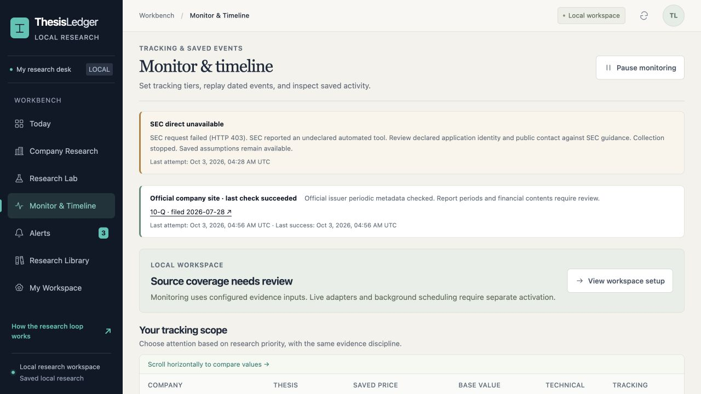

# Verification record

Checked locally on 2026-10-02 and 2026-10-03 (America/Chicago). This record describes v0.2.2 source and installation checks, with earlier UI walkthroughs identified separately. It does not certify a deployed service, complete EXE valuation or investment performance.

## Local checks

| Check | Result |
| --- | --- |
| Full Python suite | 162 tests passed on Python 3.12 and Python 3.14; zero failures and errors in each final run |
| Public case benchmark | 19 checks passed: 16 manually cross-checked facts from two EXE 10-Ks and three workflow guards |
| Python compilation and JavaScript syntax | Passed |
| UI state regressions | Three Node checks passed against the actual controller functions: unchanged refresh preserves the sandbox/run; a changed baseline invalidates the Lab cache after off-page refresh or acceptance |
| Real loopback HTTP boundary | Passed with permission to bind local test ports |
| Commodity calculations | Cash-flow relationships, financing and cumulative-reserve guards, explicit forward assumptions and dated opening-balance bridge passed |
| SEC parsing and timing | Exact concept/unit/period/accession selection, conflicts, unavailable facts, Eastern disclosure-date boundaries, DST and timezone-data fallback passed |
| Official issuer adapter | 24 focused checks passed: grounded filing rows, amendments, ARS exclusion, unknown report periods, bounded transport/cache, robots refusal, nested-table rejection, independent source status and verified cross-source deduplication |
| Proposal integrity | Canonical full-packet identity, reviewed-source checks, locked acceptance, recomputation, tampered-payload rejection and preserved model history passed |
| Bounded Agent runtime | Allowlisted tools, step budgets, citation validation, nonfinite/private-field rejection, mocked provider failures, immutable saves and tamper rejection passed |
| Run reproduction | Offline execution of recorded decisions matched the saved output hash in source and isolated installed-package checks |
| Numeric and input boundaries | Extreme finite inputs with overflowing calculations return unavailable with strict valid JSON; malformed financial objects return HTTP 400 without persistence |
| Saved-run size and corruption | The original 2,772,612-byte regression record indexes, loads and replays through engine and CLI; corrupt or wrong-hash filenames cannot hide valid records |
| Offline wheel and isolated installation | Passed on Python 3.12 outside the checkout; entry command, EXE resource, all three UI assets, scenario lab, three review suggestions, replay and benchmark checked |
| Desktop walkthrough | Earlier v0.2.1 scenario, review, replay and unchanged refresh checks retained; v0.2.2 additionally displays a real issuer-discovered alert, separate SEC failure, source link, unknown report period and date-only availability explanation |
| Narrow walkthrough | v0.2.2 monitor checked at 390 x 844; document width 390, table scrolls inside its 356-pixel region. Repaired an off-screen accessible label that expanded page width |
| Local notification behavior | Review events and mocked new-periodic-filing checks produce deduplicated local alerts; pause prevents collector calls, repeated failures produce one redacted source-status alert per outage, recovery is quiet; no email sent |

The independent financial review cross-checked issuer, fiscal periods, units, acquisition comparability and cash/share definitions against the two official SEC reports. It found acceptance and dated-balance defects, which were repaired and independently rechecked. The UI review also corrected missing-value wording and stale alert counts while preserving sandbox inputs.

A focused independent v0.2.1 review reproduced and rechecked the arithmetic-overflow, malformed-mapping and large-run regressions. It also checked pause, failure deduplication, quiet recovery and a second outage in isolated public-fixture workspaces. Financial assumptions, revisions and forecast cohorts remained unchanged by source-status events. Its final UI review found a cached-baseline defect after navigating away from Research Lab; central state invalidation repairs it, with three controller regression checks. Browser checks distinguish collector status from verified filing evidence and show the actual last attempt.

The independent v0.2.2 review found two defects: unverified filing mentions suppressed official discovery, and nested tables could supply accepted listing cells. Both were repaired and rechecked with the original probes. It verified cross-source deduplication, one outage alert despite changing sanitized failure reasons, and preservation of SEC failure, financial assumptions, histories and forecast cohorts after issuer success. It made no live requests.

## Live collection evidence and failure

Earlier source-checkout collection succeeded against the two official SEC JSON endpoints. The captured responses were 166,058 bytes (submissions) and 4,841,176 bytes (companyfacts), retrieved at 2026-10-03 02:45 UTC. A separate live `collect_company` check at 02:57 UTC returned both sources and 1,000 recent filing records; their hashes matched the original captures.

The v0.2 installed-wheel `sec-watch` attempt failed with HTTP 403 on its first GET. A v0.2.1 source probe failed again at 2026-10-03 04:07 UTC. The v0.2.2 diagnostic GET at 04:28 UTC returned HTTP 403 with **Undeclared Automated Tool** in the error page. This classifies the refusal; the underlying cause is not uniquely established, and a user-supplied public project contact has not been tested. No successful SEC recovery is claimed. See [SEC access guidance](https://www.sec.gov/about/webmaster-frequently-asked-questions).

The official EXE investor website returned HTTP 200 for its robots policy and annual/quarterly listing pages. A real `ir-watch EXE --once` check completed at **2026-10-03 04:56:34 UTC**: three bounded GETs, hash-verified raw captures, accession `0000895126-26-000047` (10-Q, issuer-listed filing date July 28, 2026), and **one new local review alert**. Its report period remains unknown. No new financial figures were extracted or accepted. Financials, assumptions and the dated balance-sheet bridge still equal the packaged baseline; model history retains one revision. The workbench displayed the real alert and independent source statuses. Its SEC failure was restored from the exact earlier diagnostic timestamp, not generated by a second SEC request.

Initial issuer attempts with an unversioned application string timed out. Another system client recorded an HTTP/2 protocol error; HTTP/1.1 and a second Python version also timed out. After adopting the project's truthful versioned identifier and public owner link, the product check succeeded. This sequence does not prove the identifier caused recovery. Continuous availability and long-running unattended operation remain unverified. There was no browser impersonation, proxy rotation, automatic fallback or retry after SEC refusal. The packaged EXE financial case remains usable offline.

## Walkthrough evidence

The EXE figures are public historical facts. Forward parameters are educational model assumptions. Displayed values are conditional outputs, with historical opening cash/debt and an annual weighted EPS share proxy. They are not current investment targets. No current market quote is supplied.

## Scope still unverified

- Python 3.10 is configured in CI but was not exercised locally. GitHub Actions has not run remotely for this version.
- Hosted tool calling is implemented and tested with mocked responses. No real hosted LLM inference, reasoning quality or token cost was measured.
- Cloud hosting, TLS proxy operation, service supervision and actual SMTP/inbox delivery remain unverified. Self-hosting instructions describe a deployment route, not an existing public service.
- Issuer collection passed one live EXE check. It covers the first annual and quarterly listing pages only; continuous availability, complete filing history, report-body extraction and other issuer adapters are unverified.
- This case does not provide a full hedge/marketing model, maintenance-capital proof, current financing/dilution bridge, current price, exhaustive filing/news history or investment-performance validation.
- The benchmark covers this fixed two-filing case. It does not measure unseen-company extraction accuracy, general model accuracy or trading returns.
- Hashes and replay check local integrity and computation. They do not independently certify source authenticity, correct investment assumptions or source redistribution rights.
- The known-field privacy guard is not a redaction engine. Arbitrary caller-supplied prose and URLs require review before sharing.
- No Git stage, commit, push, PR, package publication, deployment or external notification was performed.
